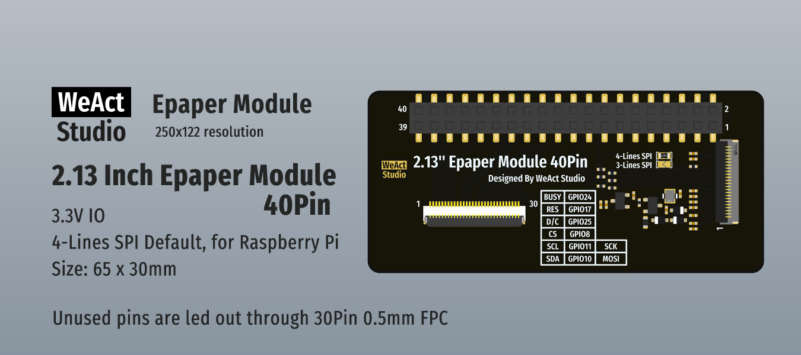

# WeAct Studio Epaper Module 40Pin 2.13Inch

## 40Pin Definition (Raspberry Pi 40Pin)
| wPi       | BCM     | Pin  | Pin  | BCM     | wPi       |
|:---------:|:-------:|:----:|:----:|:-------:|:---------:|
| P_VDD33   | VDD33   |**1** |**2** | 5V      | P_5V      |
| P_SDA1    | GPIO2   |**3** |**4** | 5V      | P_5V      |
| P_SCL1    | GPIO3   |**5** |**6** | GND     | GND       |
| P_GPIO7   | GPIO4   |**7** |**8** | GPIO14  | P_TXD     |
| GND       | GND     |**9** |**10**| GPIO15  | P_RXD     |
|**P_GPIO0**|**GPIO17(RES)**|**11**|**12** | GPIO18  | P_GPIO1   |
| P_GPIO2   | GPIO27  |**13**|**14**| GND     | GND       |
| P_GPIO3   | GPIO22  |**15**|**16**| GPIO23  | P_GPIO4   |
| P_VDD33   | VDD33   |**17**|**18**| **GPIO24(BUSY)**  | **P_GPIO5**   |
| **P_MOSI**| **GPIO10(MOSI)**|**19**|**20** | GND     | GND       |
| P_MISO    | GPIO9   |**21**|**22**| **GPIO25(D/C)**|**P_GPIO6**|
| **P_SCK** | **GPIO11(SCK)**|**23**|**24** | **GPIO8(CS)**|**P_CE0**|
| GND       | GND     |**25**|**26**| GPIO7   | P_CE1     |
| P_SDA0    | GPIO0   |**27**|**28**| GPIO1   | P_SCL0    |
| P_GPIO21  | GPIO5   |**29**|**30**| GND     | GND       |
| P_GPIO22  | GPIO6   |**31**|**32**| GPIO12  | P_GPIO26  |
| P_GPIO23  | GPIO13  |**33**|**34**| GND     | GND       |
| P_GPIO24  | GPIO19  |**35**|**36**| GPIO16  | P_GPIO27  |
| P_GPIO25  | GPIO26  |**37**|**38**| GPIO20  | P_GPIO28  |
| GND       | GND     |**39**|**40**| GPIO21  | P_GPIO29  |

## 30Pin FPC Definition (Unused pins)
> FPC wiring has two types: the same-direction and the opposite-direction. When using the same-direction wiring, the pin definitions should be reversed.  

| Pin  | BCM     | wPi       | BCM(Reverse) | wPi(Reverse) |
|------|---------|-----------|--------------|--------------|
|**1** | GND     | GND       | VDD33        | P_VDD33      |
|**2** | GPIO21  | P_GPIO29  | 5V           | P_5V         |
|**3** | GPIO20  | P_GPIO28  | GPIO2        | P_SDA1       |
|**4** | GPIO26  | P_GPIO25  | 5V           | P_5V         |
|**5** | GPIO16  | P_GPIO27  | GPIO3        | P_SCL1       |
|**6** | GPIO19  | P_GPIO24  | GND          | GND          |
|**7** | GPIO13  | P_GPIO23  | GPIO4        | P_GPIO7      |
|**8** | GPIO12  | P_GPIO26  | GPIO14       | P_TXD        |
|**9** | GPIO6   | P_GPIO22  | GPIO15       | P_RXD        |
|**10**| GND     | GND       | GPIO18       | P_GPIO1      |
|**11**| GPIO5   | P_GPIO21  | GPIO27       | P_GPIO2      |
|**12**| GPIO1   | P_SCL0    | GPIO22       | P_GPIO3      |
|**13**| GPIO0   | P_SDA0    | GPIO23       | P_GPIO4      |
|**14**| GPIO7   | P_CE1     | VDD33        | P_VDD33      |
|**15**| GND     | GND       | GPIO9        | P_MISO       |
|**16**| GPIO9   | P_MISO    | GND          | GND          |
|**17**| VDD33   | P_VDD33   | GPIO7        | P_CE1        |
|**18**| GPIO23  | P_GPIO4   | GPIO0        | P_SDA0       |
|**19**| GPIO22  | P_GPIO3   | GPIO1        | P_SCL0       |
|**20**| GPIO27  | P_GPIO2   | GPIO5        | P_GPIO21     |
|**21**| GPIO18  | P_GPIO1   | GND          | GND          |
|**22**| GPIO15  | P_RXD     | GPIO6        | P_GPIO22     |
|**23**| GPIO14  | P_TXD     | GPIO12       | P_GPIO26     |
|**24**| GPIO4   | P_GPIO7   | GPIO13       | P_GPIO23     |
|**25**| GND     | GND       | GPIO19       | P_GPIO24     |
|**26**| GPIO3   | P_SCL1    | GPIO16       | P_GPIO27     |
|**27**| 5V      | P_5V      | GPIO26       | P_GPIO25     |
|**28**| GPIO2   | P_SDA1    | GPIO20       | P_GPIO28     |
|**29**| 5V      | P_5V      | GPIO21       | P_GPIO29     |
|**30**| VDD33   | P_VDD33   | GND          | GND          |

## 2x15P 2.54mm Definition (Unused pins)
| wPi(Reverse) | BCM(Reverse) | wPi       | BCM     | Pin  | Pin  | BCM     | wPi       | BCM(Reverse) | wPi(Reverse) |
|--------------|--------------|-----------|---------|------|------|---------|-----------|--------------|--------------|
| P_VDD33      | VDD33        | GND       | GND     | **1** | **2** | GPIO21  | P_GPIO29  | 5V           | P_5V         |
| P_SDA1       | GPIO2        | P_GPIO28  | GPIO20  | **3** | **4** | GPIO26  | P_GPIO25  | 5V           | P_5V         |
| P_SCL1       | GPIO3        | P_GPIO27  | GPIO16  | **5** | **6** | GPIO19  | P_GPIO24  | GND          | GND          |
| P_GPIO7      | GPIO4        | P_GPIO23  | GPIO13  | **7** | **8** | GPIO12  | P_GPIO26  | GPIO14       | P_TXD        |
| P_RXD        | GPIO15       | P_GPIO22  | GPIO6   | **9** | **10** | GND     | GND       | GPIO18       | P_GPIO1      |
| P_GPIO2      | GPIO27       | P_GPIO21  | GPIO5   | **11** | **12** | GPIO1   | P_SCL0    | GPIO22       | P_GPIO3      |
| P_GPIO4      | GPIO23       | P_SDA0    | GPIO0   | **13** | **14** | GPIO7   | P_CE1     | VDD33        | P_VDD33      |
| P_MISO       | GPIO9        | GND       | GND     | **15** | **16** | GPIO9   | P_MISO    | GND          | GND          |
| P_CE1        | GPIO7        | P_VDD33   | VDD33   | **17** | **18** | GPIO23  | P_GPIO4   | GPIO0        | P_SDA0       |
| P_SCL0       | GPIO1        | P_GPIO3   | GPIO22  | **19** | **20** | GPIO27  | P_GPIO2   | GPIO5        | P_GPIO21     |
| GND          | GND          | P_GPIO1   | GPIO18  | **21** | **22** | GPIO15  | P_RXD     | GPIO6        | P_GPIO22     |
| P_GPIO26     | GPIO12       | P_TXD     | GPIO14  | **23** | **24** | GPIO4   | P_GPIO7   | GPIO13       | P_GPIO23     |
| P_GPIO24     | GPIO19       | GND       | GND     | **25** | **26** | GPIO3   | P_SCL1    | GPIO16       | P_GPIO27     |
| P_GPIO25     | GPIO26       | P_5V      | 5V      | **27** | **28** | GPIO2   | P_SDA1    | GPIO20       | P_GPIO28     |
| P_GPIO29     | GPIO21       | P_5V      | 5V      | **29** | **30** | VDD33   | P_VDD33   | GND          | GND          |